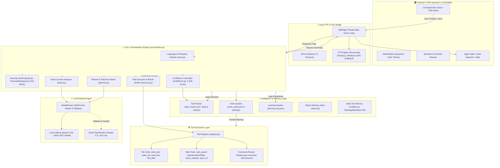
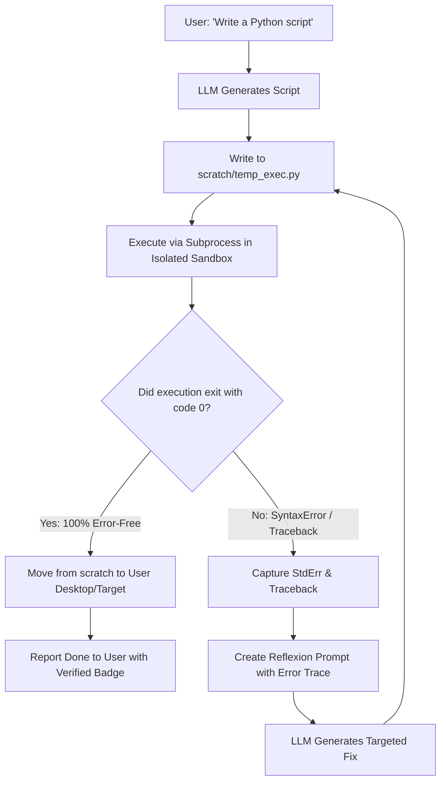
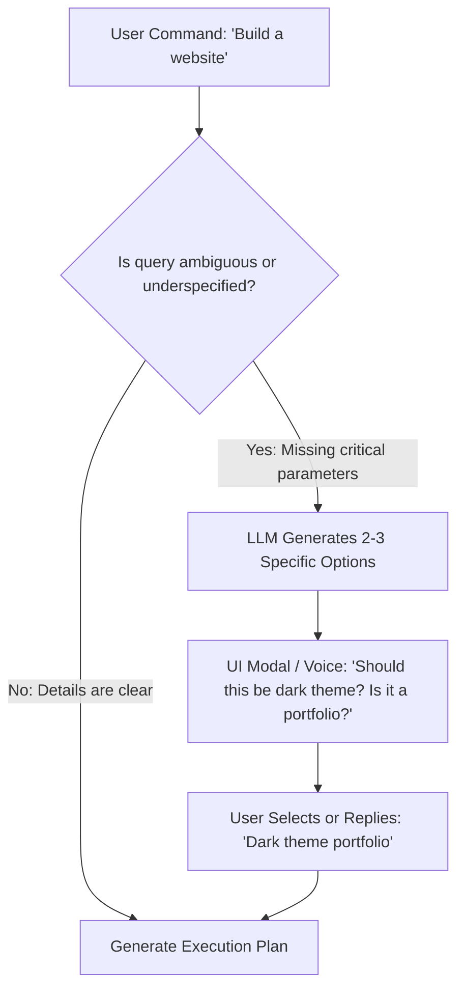
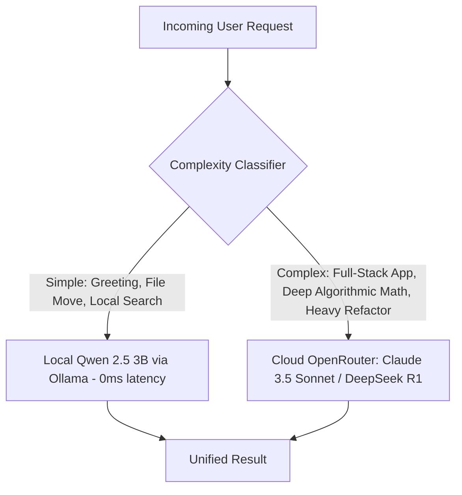

# 🌌 STAR Agent: Master Architecture, File-by-File Technical Encyclopedia & Autonomous Intelligence Roadmap

**Document Classification:** Production Master Specification  
**Current Live Version:** v2.6  
**Date:** 2026-10-26  
**Primary Engine:** Local GPU-Offloaded `qwen2.5:3b` via Ollama + Cloud OpenRouter Tier  
**Benchmark Verification:** 45/45 Passed (100.0%)  

---

## 📑 Table of Contents
1. [Executive Overview & System Architecture](#1-executive-overview--system-architecture)
2. [Master Architecture Diagram](#2-master-architecture-diagram)
3. [File-by-File Technical Encyclopedia](#3-file-by-file-technical-encyclopedia)
   - *3.1 Root Configuration, Metadata & History Files*
   - *3.2 star_core/ — Core Orchestration Engine*
   - *3.3 star_core/brain/ — Planning, Location Resolution & Confidence*
   - *3.4 star_core/llm/ — Local & Cloud LLM Router*
   - *3.5 star_core/memory/ — Multi-Tier Memory & Task Tracker*
   - *3.6 star_core/security/ — Permissions, Security Guards & Undo Engine*
   - *3.7 star_core/tools/ — Native Executable Tools*
   - *3.8 star_core/voice/ — Speech Recognition & Dual-TTS Engine*
   - *3.9 star_ui/ — Quantum Cyberpunk Visual Interface*
4. [End-to-End Request Execution Lifecycle Diagram](#4-end-to-end-request-execution-lifecycle-diagram)
5. [Roadmap to True Autonomous Super-Intelligence](#5-roadmap-to-true-autonomous-super-intelligence)
   - *5.1 Runtime Self-Healing & Sandbox Reflexion Loop*
   - *5.2 Socratic Proactive Requirement Gathering*
   - *5.3 Autonomous Self-Evolution: Meta-Patching via LLM*
   - *5.4 Production Quality Gate & Senior Developer Critic (LLM-as-a-Judge)*
   - *5.5 Hybrid Dual-Brain Orchestration (Local 3B + Cloud Flagship)*
6. [Implementation Priority Matrix](#6-implementation-priority-matrix)

---

## 1. Executive Overview & System Architecture

**STAR (Quantum Assistant)** is an offline-first, hybrid-capable, autonomous agentic platform. It is not merely a conversational chatbot; it is a full-fledged agent capable of creating and managing files and folders on disk, synthesizing Python scripts and responsive websites, conducting automated live web research, calculating task confidence, enforcing security policies, and performing atomic rollbacks upon failure.

### 🌟 Core Architectural Principles:
1. **Deterministic Execution:** The LLM proposes plans and code snippets, but actions on disk, parameter validation, and post-execution checks are governed entirely by deterministic, thread-safe Python code.
2. **Zero-Guess Security:** The agent is strictly locked into 4 user-approved root directories (`Desktop`, `Downloads`, `Documents`, `STAR_workspace`). Any attempt to operate outside these boundaries is halted immediately.
3. **Always Reversible (Atomic Backups):** Prior to modifying or creating any file, a timestamped snapshot is archived into `backup/`, ensuring single-click or multi-step rollbacks.
4. **Native Multilingual & Banglish Understanding:** The system processes English, native Bengali script, and phonetic Romanized Bengali (Banglish) seamlessly without losing context or intent.

---

## 2. Master Architecture Diagram

The diagram below illustrates the end-to-end connectivity between all frontend, orchestrator, memory, security, and tooling subsystems:



---

## 3. File-by-File Technical Encyclopedia

Below is a complete, granular reference guide detailing the purpose, methods, data structures, and role of every single file in the repository:

```
c:\Users\nilan\Downloads\star_quantum_ui (3)\star_quantum_ui
│
├── run_star.py                      ── Main application entry point & Qt/CLI bootstrap
├── agent_skills.md                  ── Permanent 10-section skill set + Advanced Protocol
├── skill_test_results.md            ── 45/45 benchmark test execution report
├── task_tracker.json                ── Live agent stats, task history, recurring errors & prevention rules
├── undo_stack.json                  ── Active action stack for multi-step rollbacks
├── security_log.json                ── Security incident log (traversal, command blocks, key leaks)
├── learning_log.json                ── Persistent knowledge store for user preferences & learned patterns
│
├── star_core/                       ── Central Agent Backend
│   ├── app.py                       ── Dependency injection & component assembly
│   ├── config.py                    ── Global configuration, model endpoints & paths
│   ├── executor.py                  ── Plan execution & step verification engine
│   ├── metrics.py                   ── Latency, memory node count & throughput metrics
│   ├── models.py                    ── Core dataclasses (Analysis, Plan, StepOutcome, TaskReport)
│   ├── orchestrator.py              ── Central orchestrator driving user turn lifecycle
│   ├── qt_bridge.py                 ── Thread-safe Qt IPC bridge & dual-TTS fallback
│   ├── reporter.py                  ── Multilingual user-facing report generator
│   ├── resolver_text.py             ── Translation & localized strings helper
│   ├── selftest.py                  ── Diagnostic self-test suite
│   ├── text.py                      ── Phonetic Banglish & Bengali language detector
│   └── ui_port.py                   ── Abstract interface decoupling UI from backend logic
│
├── star_core/brain/                 ── Cognitive & Planning Subsystem
│   ├── brain.py                     ── Intent analyzer & direct answer generator
│   ├── confidence.py                ── Pre-task 0-100 confidence score calculator
│   ├── planner.py                   ── Multi-step planner, dependency sorter & replanner
│   ├── prompts.py                   ── System prompts & strict JSON formatting instructions
│   └── resolver.py                  ── Location & path resolver with root directory priority
│
├── star_core/llm/                   ── LLM Connection & Routing Subsystem
│   ├── base.py                      ── Base LLM interface & response token telemetry
│   ├── mock.py                      ── Deterministic mock LLM for testing
│   ├── ollama.py                    ── High-speed local Ollama client (qwen2.5:3b)
│   ├── openrouter.py                ── Cloud OpenRouter client for complex reasoning fallback
│   └── router.py                    ── Resilient router with automatic JSON bracket repair
│
├── star_core/memory/                ── Persistent Memory & Tracking Subsystem
│   ├── learning_system.py           ── AgentLearningSystem managing learning_log.json
│   ├── multitier.py                 ── Working, episodic, and long-term memory tiering
│   ├── retrieval.py                 ── Context pack assembler for semantic retrieval
│   ├── store.py                     ── SQLite-backed permanent storage
│   └── task_tracker.py              ── TaskTracker managing task_tracker.json & live dashboard
│
├── star_core/security/              ── Security & Rollback Subsystem
│   ├── guard.py                     ── SecurityGuard (Path Traversal, Cmd Block, Key Masking)
│   ├── policy.py                    ── PermissionPolicy enforcing allowed folder boundaries
│   └── undo_system.py               ── UndoSystem managing backup/ and undo_stack.json
│
├── star_core/skills/                ── Skill Distillation Subsystem
│   ├── learner.py                   ── Distills verified tasks into permanent skills
│   └── registry.py                  ── On-disk JSON skill loader and executor
│
├── star_core/tools/                 ── Native Tooling Subsystem
│   ├── base.py                      ── Tool abstract base class with type coercion
│   ├── files.py                     ── write_text, read_text, delete_file, make_dir, list_dir
│   ├── registry.py                  ── Central registry of all accessible tools
│   ├── runner.py                    ── Subprocess runner with timeout & cancellation
│   ├── search.py                    ── Local file search and glob patterns
│   ├── system.py                    ── OS and system telemetry tools
│   ├── web.py                       ── WebSearch tool via DuckDuckGo and Wikipedia
│   └── website.py                   ── Local HTTP server and web preview launcher
│
├── star_core/voice/                 ── Audio & Speech Subsystem
│   ├── speech.py                    ── Speech recognition & voice input processing
│   └── elevenlabs.py                ── ElevenLabs streaming TTS client
│
└── star_ui/                         ── Quantum Cyberpunk User Interface (PySide6)
    ├── main_window.py               ── Frameless custom window with controls and tab host
    ├── theme.py                     ── Cyberpunk Quantum Dark palette with neon cyan accents
    ├── waveform.py                  ── Real-time audio waveform visualizer
    ├── reactor.py / particles.py    ── Particle simulation and dynamic background effects
    ├── command_bar.py               ── Animated text & voice input bar
    └── tabs/                        ── Agent reasoning tab, code preview, and telemetry views
```

---

### Detailed File Specifications:

#### 1. `run_star.py`
- **Role:** Main executable entry point.
- **Functionality:** Parses command-line flags (e.g. `--check`, `--mock-llm`), initializes the PySide6 `QApplication`, applies the visual theme, and launches the `BackendRunner` thread in the background.

#### 2. `star_core/orchestrator.py`
- **Role:** Central nervous system of STAR.
- **Key Methods:**
  - `handle(text)`: Receives user text/voice input and initiates processing.
  - `_fast_reply(text)`: Executes immediate (<0.02s) responses for greetings, system time, and quick commands (`stats dekhao`, `dashboard dekhao`, `undo koro`).
  - `_understand(text)`: Analyzes intent, extracts entities, and validates location paths.
  - `_make_plan()`: Generates steps via `Planner`, injects prevention rules, and removes unrequested preview steps.
  - `_approve()`: Displays the approval modal with risk assessment and confidence score.
  - `_execute()`: Triggers pre-execution backups and executes steps sequentially.
  - `_conclude()`: Verifies execution on disk, updates `task_tracker.json`, and streams the speech response.

#### 3. `star_core/brain/confidence.py`
- **Role:** Pre-task confidence calculation engine (Section A).
- **Scoring Breakdown:**
  - Prior task experience: +20
  - High prior success rate: +15
  - Required tools verified: +15
  - Specific, unambiguous instruction: +15
  - Prior failures on same type: -20
  - Multi-step task (>=3 steps): -10
  - External API / network dependency: -10
  - Heavy reasoning load for 3B model: -15
- **Safety Gate:** If confidence falls below 40, task execution is blocked and a clarification question is asked instead.

#### 4. `star_core/security/undo_system.py`
- **Role:** Atomic file rollback engine (Section B).
- **Functionality:** Before any write or delete operation, creates a timestamped copy in `backup/` or `backup/deleted/`. Manages `undo_stack.json` and supports single-step undo (`undo()`), multi-step undo (`undo_steps(n)`), and complete task rollback (`rollback()`).

#### 5. `star_core/security/guard.py`
- **Role:** Real-time security watchdog (Sections C & D).
- **Functionality:** Intercepts path traversal patterns (`../`), detects dangerous commands (`rm -rf`, `format C:`, `del /s /q`), sanitizes HTML injection, masks API keys (`sk-****`), and halts execution if an infinite loop is detected (>=3 identical tool invocations).

#### 6. `star_core/memory/task_tracker.py`
- **Role:** Task auditing and live performance tracking.
- **Functionality:** Persists records to `task_tracker.json`, writes structured incident reports to `error_logs/error_XXX.txt`, and generates live ASCII performance tables and JSON telemetry for the `"dashboard dekhao"` command.

#### 7. `star_core/brain/resolver.py`
- **Role:** Natural language directory resolver.
- **Optimization:** Matches user words like `"Desktop"`, `"Downloads"`, and `"Documents"` directly to root paths in 0ms, avoiding redundant deep recursive scans across subdirectories.

#### 8. `star_core/tools/web.py`
- **Role:** Live web research tool.
- **Functionality:** Queries DuckDuckGo Instant Answer and Wikipedia search APIs, returning fact-checked data without requiring third-party API keys.

---

## 4. End-to-End Request Execution Lifecycle Diagram

The sequence diagram below illustrates how an input request flows across security, planning, execution, and verification:

```mermaid
sequenceDiagram
    autonumber
    actor User as 👤 User (Voice/Chat)
    participant UI as 🖥️ MainWindow / CommandBar
    participant Bridge as 🌉 QtBridge / Worker
    participant Orch as 🧠 Orchestrator
    participant Guard as 🛡️ SecurityGuard
    participant Brain as 💡 Brain & Resolver
    participant Conf as 🎯 ConfidenceCalculator
    participant Planner as 📋 Planner
    participant Undo as ⏪ UndoSystem
    participant Exec as ⚙️ Executor & Tools
    participant Tracker as 📊 TaskTracker

    User->>UI: "Desktop e ekta python script lekho jeta fibonacci number ber kore"
    UI->>Bridge: emit submit(text)
    Bridge->>Orch: handle(text)
    
    rect rgb(30, 40, 55)
        Note over Orch, Guard: Phase 1: Security & Fast-Reply Check
        Orch->>Guard: check_path_traversal & check_dangerous_commands
        Guard-->>Orch: Clean (Passed)
        Orch->>Orch: check _fast_reply (Not a generic chitchat)
    end

    rect rgb(35, 50, 40)
        Note over Orch, Brain: Phase 2: Intent Analysis & Path Resolution
        Orch->>Brain: analyze(text, memory, language)
        Brain-->>Orch: Analysis (intent: create_python_script, folder: Desktop)
        Orch->>Brain: resolve_location("Desktop")
        Brain-->>Orch: ResolvedPath(C:\Users\nilan\Desktop)
    end

    rect rgb(45, 40, 30)
        Note over Orch, Conf: Phase 3: Planning & Confidence Scoring
        Orch->>Planner: plan(analysis, prevention_hints)
        Planner-->>Orch: Plan(Step 1: make_dir, Step 2: write_text)
        Orch->>Conf: calculate(text, plan.steps)
        Conf-->>Orch: Confidence: 85/100, Risk: Low, CanProceed: True
    end

    rect rgb(40, 30, 50)
        Note over Orch, UI: Phase 4: User Approval (if Risk >= Medium)
        Orch->>UI: request_approval(Title, Steps, Confidence: 85/100)
        UI->>User: Display Approval Modal
        User->>UI: Click 'Approve'
        UI-->>Orch: Approved (True)
    end

    rect rgb(30, 50, 60)
        Note over Orch, Exec: Phase 5: Backup & Safe Execution
        Orch->>Undo: backup_before_action(target_path, "write_text")
        Undo-->>Undo: Saved snapshot in backup/
        Orch->>Exec: run_plan(plan)
        Exec->>Exec: Step 1 (make_dir) -> Verified
        Exec->>Exec: Step 2 (write_text) -> Verified on Disk
        Exec-->>Orch: Outcomes: [Verified, Verified]
    end

    rect rgb(30, 45, 35)
        Note over Orch, Tracker: Phase 6: Bookkeeping & Reporting
        Orch->>Tracker: record_task(status: SUCCESS, steps_done, time)
        Tracker-->>Tracker: Update task_tracker.json & success_rate
        Orch->>Bridge: say("✅ Task complete! File saved on Desktop...")
        Bridge->>UI: Update Output Tab & Stream TTS Voice Audio
        UI-->>User: Green Checkmark & Spoken Voice Feedback
    end
```



---

## 5. Roadmap to True Autonomous Super-Intelligence

While STAR currently operates as a reliable, secure agent, transitioning into a true **Autonomous Senior AI Engineer** requires bridging five core gaps through the following subsystems:

---

### 5.1 Runtime Self-Healing & Sandbox Reflexion Loop

#### Architectural Flowchart:


#### Core Functionality:
- Code is never deployed directly to the user's destination without prior validation.
- The script is compiled in an isolated sandbox (`scratch/`) and executed using a test runner.
- If an error occurs, the traceback is piped back into the model to attempt up to 3 automatic fixes.
- The user only receives code that is **guaranteed to run without syntax or runtime exceptions**.

---

### 5.2 Socratic Proactive Requirement Gathering

#### Architectural Flowchart:


#### Core Functionality:
- Replaces uneducated guessing with polite, targeted clarification.
- When an underspecified prompt is detected, the agent presents 2–3 concrete options to establish requirements before generating assets.

---

### 5.3 Autonomous Self-Evolution: Meta-Patching via LLM

#### Architectural Flowchart:
```mermaid
graph TD
    AuditCmd[User: 'Improve yourself' OR Weekly Self-Audit] --> Scan[Inspect source files in star_core/]
    Scan --> AnalyzeWeakness[LLM analyzes bottlenecks from error_logs/ & task_tracker.json]
    AnalyzeWeakness --> ProposeDiff[LLM generates clean Code Patch / Diff]
    ProposeDiff --> BackupCurr[Backup current file to backup/self_evolution/]
    BackupCurr --> ApplyToScratch[Apply patch in temporary test environment]
    ApplyToScratch --> RunPyTest[Run benchmark_45_tests.py]
    TestResult{Did all 45+ tests pass with 0 regressions?}
    RunPyTest --> TestResult
    TestResult -->|Yes: Safe to upgrade| LivePatch[Hot-swap source file & reload modules]
    LivePatch --> UserReport[Notify User: 'Self-improved [Module] with 100% verified test pass']
    TestResult -->|No: Broken patch| Rollback[Revert from backup & log issue in learning_log]
```

#### Core Functionality:
- Enables the agent to inspect its own Python code, identify recurring errors from `task_tracker.json`, and synthesize a self-improvement diff.
- Runs the 45-test benchmark suite; if zero regressions are detected, the patch is deployed live with rollback safety.

---

### 5.4 Production Quality Gate & Senior Developer Critic (LLM-as-a-Judge)

#### Evaluation Criteria:
1. **Python Synthesis:** Strict type annotations (`def fib(n: int) -> list[int]`), docstrings, input assertions, and `if __name__ == '__main__':` execution blocks.
2. **Web Synthesis:** Vanilla CSS, responsive flex/grid layouts, dark glassmorphism styling, and mobile media queries (`@media (max-width: 768px)`).
3. **Research Synthesis:** Structured markdown, multi-source cross-verification, and cited evidence.

---

### 5.5 Hybrid Dual-Brain Orchestration (Local 3B + Cloud Flagship)

#### Architectural Flowchart:


#### Core Functionality:
- Routine and privacy-sensitive queries run entirely on the local 3B model (instantaneous, offline, zero token cost).
- Heavy algorithmic tasks or full-stack software development automatically escalate to a cloud flagship model.

---

## 6. Implementation Priority Matrix

| Phase | Subsystem | Target File | Core Deliverable | Status |
|---|---|---|---|---|
| **Phase 1** | **Sandbox Auto-Compile Loop** | `star_core/brain/reflexion.py` | Automated background compilation and 3-attempt self-healing | 🚀 Ready to Implement |
| **Phase 2** | **Socratic Clarification Protocol** | `star_core/brain/clarifier.py` | Proactive multi-choice clarification for ambiguous instructions | ⏳ Next Phase |
| **Phase 3** | **Production Quality Critic** | `star_core/security/quality_gate.py` | Senior-developer quality auditing for code and web artifacts | ⏳ Next Phase |
| **Phase 4** | **Hybrid Cloud Auto-Escalation** | `star_core/llm/router.py` | Seamless automatic handoff from local 3B to cloud models | ⏳ Next Phase |
| **Phase 5** | **Self-Evolution Engine** | `star_core/evolution/patcher.py` | Autonomous source-code inspection, patch synthesis, and safe deployment | 🧬 Ultimate Goal |

---

## 🏁 Conclusion & Next Steps
This specification documents the live technical state of every file in the STAR repository and outlines the concrete architectural roadmap required to achieve industry-leading autonomous agency.

**Immediate Action:**  
With user consent, implementation can begin on **Phase 1: Sandbox Auto-Compile Loop (`reflexion.py`)**, ensuring that all code generated by the agent is automatically tested, debugged, and verified before reaching the user's workspace.
