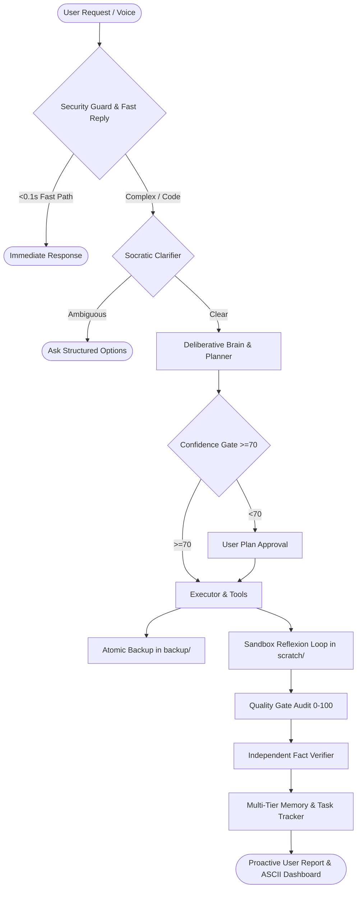

# 🌌 STAR Documentation Portal & Technical Index

Welcome to the **STAR (Quantum Autonomous AI Assistant & Engineer)** master documentation index. This documentation suite outlines the full architecture, execution runtime, self-learning loops, safety guards, and developer workflows.

---

## 📚 Documentation Hierarchy

```
docs/
├── INDEX.md                                      # This master navigation index
├── architecture/
│   ├── HYBRID_INTELLIGENCE_BLUEPRINT.md          # Multi-tier memory, latency pipeline & training loop
│   └── STAR_PROJECT_OVERVIEW_AND_INTELLIGENCE_ROADMAP.md # Master architecture, module encyclopedia & diagrams
├── specifications/
│   └── AGENT_SYSTEM_PROMPT.md                    # Canonical 16-section autonomous system prompt (v3.0)
├── guides/
│   └── DEVELOPER_GUIDE.md                        # Setup, CLI flags, tool development & testing manual
├── benchmarks/
│   └── BENCHMARK_AND_TEST_RESULTS.md             # 45-test benchmark report & regression verification
└── reports/
    └── PHASE_REPORT.md                           # Engineering evolution & phase verification history
```

---

## 🧭 Navigation by Role & Objective

| Role / Objective | Recommended Document | Description |
|---|---|---|
| **Executive & Architecture Overview** | [STAR Technical Architecture](file:///c:/Users/nilan/Downloads/star_quantum_ui%20(3)/star_quantum_ui/docs/architecture/STAR_PROJECT_OVERVIEW_AND_INTELLIGENCE_ROADMAP.md) | High-level system topology, module encyclopedia, and full Mermaid lifecycle diagrams. |
| **Ultra-Low Latency & Memory Spec** | [Hybrid Intelligence Blueprint](file:///c:/Users/nilan/Downloads/star_quantum_ui%20(3)/star_quantum_ui/docs/architecture/HYBRID_INTELLIGENCE_BLUEPRINT.md) | VAD, sentence-level streaming TTS, 5-tier memory schema (`star_memory/`), and LoRA training criteria. |
| **Agent Prompt & Behaviors** | [Agent System Prompt v3.0](file:///c:/Users/nilan/Downloads/star_quantum_ui%20(3)/star_quantum_ui/docs/specifications/AGENT_SYSTEM_PROMPT.md) | Complete 16-section system specification for local LLM (`qwen2.5:3b`) including task tracking, confidence, and reflection rules. |
| **Developer Onboarding & Setup** | [Developer Guide](file:///c:/Users/nilan/Downloads/star_quantum_ui%20(3)/star_quantum_ui/docs/guides/DEVELOPER_GUIDE.md) | Quickstart, environment setup, CLI flags, extending tools, and safety policies. |
| **Verification & Quality Assurance** | [Benchmark Test Results](file:///c:/Users/nilan/Downloads/star_quantum_ui%20(3)/star_quantum_ui/docs/benchmarks/BENCHMARK_AND_TEST_RESULTS.md) | Full 45/45 regression benchmark breakdown, security audits, and sandbox validation tests. |
| **Milestone & History** | [Phase Evolution Report](file:///c:/Users/nilan/Downloads/star_quantum_ui%20(3)/star_quantum_ui/docs/reports/PHASE_REPORT.md) | Historical phase-by-phase test validation and architectural evolution log. |

---

## 🏛️ System Architecture Summary

STAR runs an asynchronous, feedback-driven pipeline designed for high accuracy and deterministic local execution:



---

## ⚡ Quick Links & Core Resources
- **Project Root README:** [`README.md`](file:///c:/Users/nilan/Downloads/star_quantum_ui%20(3)/star_quantum_ui/README.md)
- **Primary Agent Entry Point:** [`run_star.py`](file:///c:/Users/nilan/Downloads/star_quantum_ui%20(3)/star_quantum_ui/run_star.py)
- **Task Tracking State:** [`task_tracker.json`](file:///c:/Users/nilan/Downloads/star_quantum_ui%20(3)/star_quantum_ui/task_tracker.json)
- **Learning History:** [`learning_log.json`](file:///c:/Users/nilan/Downloads/star_quantum_ui%20(3)/star_quantum_ui/learning_log.json)
- **Undo / Rollback Stack:** [`undo_stack.json`](file:///c:/Users/nilan/Downloads/star_quantum_ui%20(3)/star_quantum_ui/undo_stack.json)
