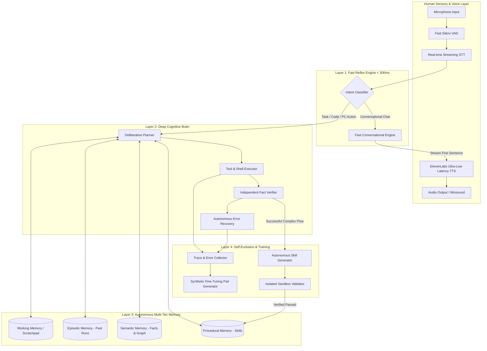
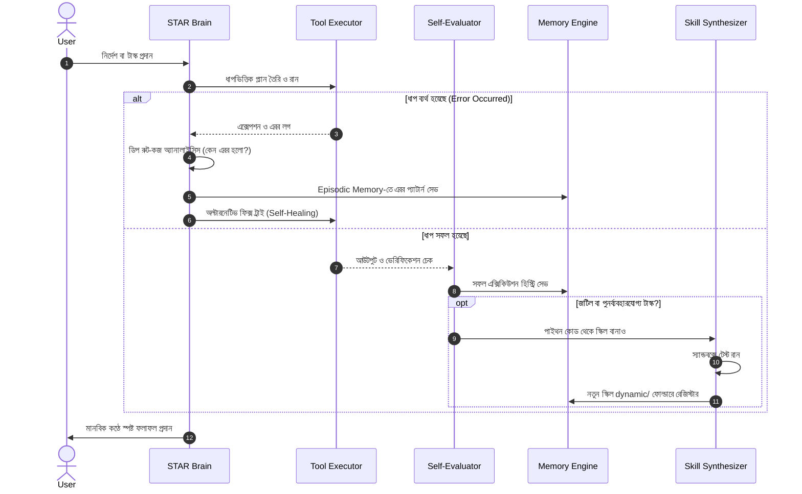
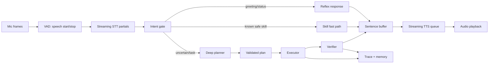
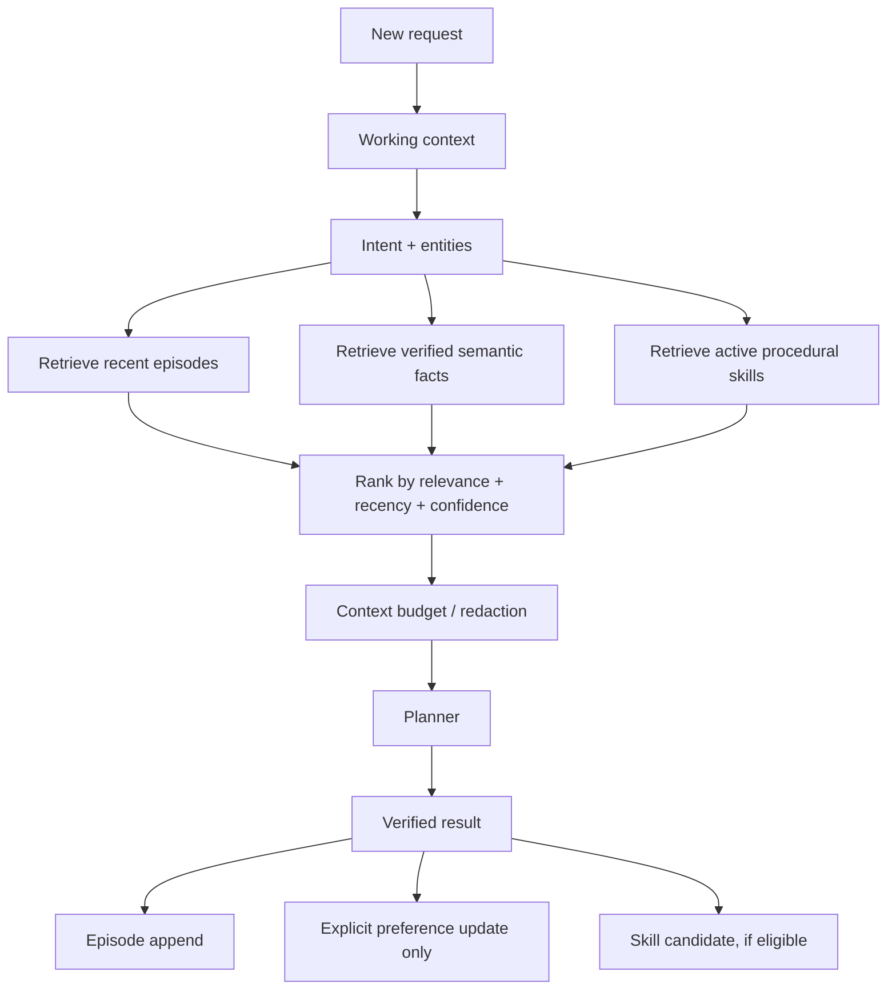
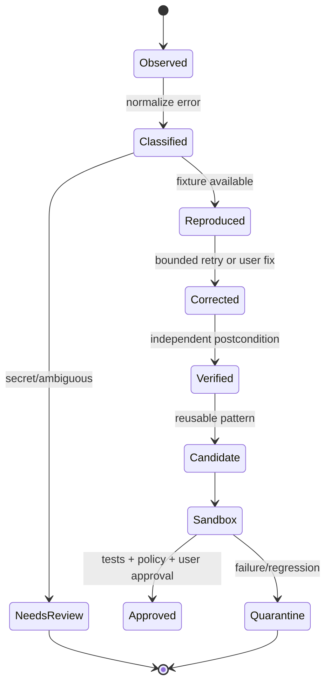

# STAR Hybrid Intelligence Architecture & Evolution Blueprint
> **System Architecture, Ultra-Low Latency Pipeline, Multi-Tier Memory Engine & Autonomous Skill Synthesis**

---

## ১. রেসপন্স দেরিতে হওয়ার মূল কারণ ও ফাস্ট করার সমাধান (Latency Root Causes & Ultra-Fast Solutions)

বর্তমানে রেসপন্স কিছুটা দেরিতে আসার কারণগুলো একটি সিকোয়েন্সিয়াল পাইপলাইনের ওপর নির্ভরশীল:

```
[কথা বলা শেষ] ──> [STT পজ ডিটেকশন (১ সেকেন্ড অপেক্ষা)] ──> [Google STT API কল] ──> 
[Ollama Local 7B পুরো উত্তর জেনারেট করা শেষ হওয়া পর্যন্ত অপেক্ষা] ──> 
[ElevenLabs API-তে সম্পূর্ণ টেক্সট পাঠানো] ──> [অডিও ডাউনলোড] ──> [প্লেব্যাক শুরু]
```
এই মডেলটিতে প্রতিটি ধাপ আগের ধাপ শেষ না হওয়া পর্যন্ত অপেক্ষা করে, যার ফলে সর্বমোট ৩–৮ সেকেন্ড বিলম্ব হয়।

### আল্ট্রা-ফাস্ট করার ৩-ধাপীয় সল্যুশন (হিউম্যান লাইক রেসপন্স < ৫০০ms):

1. **প্যারালাল স্ট্রিমিং পাইপলাইন (Sentence-Level Streaming to TTS):**
   - পুরো উত্তর তৈরি হওয়া পর্যন্ত অপেক্ষা করা যাবে না।
   - LLM যখন প্রথম ৫–৭টি শব্দ বা প্রথম পূর্ণাঙ্গ বাক্য (যতিচিহ্ন যেমন `,`, `।`, `?`, `.`) জেনারেট করবে, তখনই সেই ছোট বাক্যটি সরাসরি ElevenLabs স্ট্রিমিং API-তে পুশ হবে।
   - বাকি উত্তর ব্যাকগ্রাউন্ডে জেনারেট হতে থাকবে এবং অডিও কিউ-তে পুশ হবে। এর ফলে মানুষ কথা শেষ করার **৩০০–৫০০ মিলিসেকেন্ডের মধ্যেই অ্যাসিস্ট্যান্টের কথা শুরু হয়ে যাবে**।
2. **ফাস্ট VAD (Voice Activity Detection):**
   - বর্তমান `pause_threshold` ১.০ সেকেন্ড থেকে কমিয়ে `0.35 - 0.45` সেকেন্ডে আনা।
   - WebRTC VAD বা Silero VAD লোকাল লাইব্রেরি ব্যবহার করা যাতে মাইক্রোফোন স্তর থেকেই স্পিচ অ্যান্ড রিয়েল-টাইমে ডিটেক্ট হয়।
3. **দ্বৈত রাউটিং (Hybrid Tier LLM Routing):**
   - সাধারণ আলাপচারিতা (যেমন: "কেমন আছো?", "শুনতে পাচ্ছ?", "হ্যাঁ বলো") এর জন্য লোকাল 7B মডেল অপেক্ষা করানোর বদলে আল্ট্রা-ফাস্ট ক্লাউড গ্রোক/ক্লাউড-ফ্ল্যাশ অথবা লোকাল ১.৫B/৩B মডেল দিয়ে ইনস্ট্যান্ট রিপ্লাই দেওয়া।
   - জটিল কোডিং, ফাইল হ্যান্ডলিং ও প্ল্যানিংয়ের সময় 7B মডেল গভীর চিন্তা (Deep Reasoning) করবে।

---

## ২. হাইব্রিড ইন্টেলিজেন্স সিস্টেম আর্কিটেকচার (System Architecture Diagram)



---

## ৩. নতুন ডেডিকেটেড মেমোরি আর্কিটেকচার (`star_memory/`)

ব্রেনকে মানুষের মতো স্মরণশক্তি দিতে হলে মেমোরিকে একটি একক ফাইলের বদলে নিচের কাঠামোগত ফোল্ডারে ভাগ করে স্বয়ংক্রিয়ভাবে সিঙ্ক রাখতে হবে:

```
star_quantum_ui/
└── star_memory/
    ├── working/               # বর্তমান কথোপকথন ও রানিং টাস্কের মেমোরি
    │   └── current_session.json
    ├── episodic/              # অতীতের টাস্ক হিস্ট্রি, এরর এবং সফলতার টাইমলাইন
    │   ├── 2026-10-tasks.jsonl
    │   └── failed_patterns.jsonl
    ├── semantic/              # ব্যবহারকারীর পছন্দ, পিসির কনফিগারেশন, ফ্যাক্টস
    │   ├── user_profile.json
    │   ├── system_topology.json
    │   └── knowledge_graph.json
    └── skills_catalog/        # অটো-জেনারেটেড ও স্ব-শিক্ষিত স্কিলসমূহ
        ├── skill_registry.json
        └── dynamic/           # ব্রেন নিজে যেসব পাইথন স্কিল তৈরি করেছে
            ├── excel_cleaner.py
            ├── auto_git_commit.py
            └── website_generator.py
```

### মেমোরি টাইপগুলোর ভূমিকা:
1. **Semantic Memory (দীর্ঘমেয়াদী জ্ঞান):** ব্যবহারকারী কী পছন্দ করেন, কোন ফোল্ডারে কাজ করেন, কোন সফটওয়্যার ইনস্টল আছে—সবকিছু স্বয়ংক্রিয়ভাবে গ্রাফ আকারে থাকবে।
2. **Episodic Memory (অভিজ্ঞতা ও ভুল থেকে শিক্ষা):** কোনো কমান্ড চালাতে গিয়ে যদি সিনট্যাক্স এরর বা পারমিশন এরর আসে, ব্রেন তাৎক্ষণিকভাবে `failed_patterns.jsonl`-এ তা লিখে রাখবে। ভবিষ্যতে একই কাজ করার সময় সেই ভুল পুনরাবৃত্তি করবে না।
3. **Procedural Memory (স্কিলস):** ব্রেন যখন কোনো নতুন জটিল কাজ সাফল্যের সাথে শেষ করবে, সে তার সমাধানটি একটি রিইউজেবল ফাংশন বানিয়ে `dynamic/` ফোল্ডারে রেখে দেবে।

---

## ৪. সেলফ-ইভোলিউশন ও ট্রেনিং লুপ (Self-Evolution & Error Feedback Loop)



---

## ৫. ধাপে ধাপে বাস্তবায়ন গাইড (Implementation Roadmap for Agents & Developers)

### ধাপ ১: স্ট্রিমিং অডিও এবং ফাস্ট VAD ইন্টিগ্রেশন
* [elevenlabs.py](file:///c:/Users/nilan/Downloads/star_quantum_ui%20(3)/star_quantum_ui/star_core/voice/elevenlabs.py)-তে স্ট্রিমিং অডিও প্লেয়ার যোগ করা যা প্রথম বাফারের বাইট পাওয়া মাত্রই প্লেব্যাক শুরু করে।
* [speech.py](file:///c:/Users/nilan/Downloads/star_quantum_ui%20(3)/star_quantum_ui/star_core/voice/speech.py)-তে `pause_threshold=0.4` এবং ডাইনামিক অ্যাম্বিয়েন্ট নয়েজ ক্যাশ করা।

### ধাপ ২: স্ট্রাকচার্ড মেমোরি স্টোর তৈরি (`star_memory/`)
* একটি নতুন ডিরেক্টরি `star_memory` তৈরি করা।
* `MemoryStore`-কে আপগ্রেড করা যাতে এটি শুধু SQLite নয়, বরং হিউম্যান-রিডেবল JSONL এবং ক্যাশড মেমোরি ফাইল সিঙ্ক করে।
* প্রতি টাস্কের শেষে এরর লগ এবং লার্নিং সামারি স্বয়ংক্রিয়ভাবে ফাইলে রাইট করা।

### ধাপ ৩: সেলফ-হিলিং ও অটোমেটিক স্কিল সিন্থেসিস
* [learner.py](file:///c:/Users/nilan/Downloads/star_quantum_ui%20(3)/star_quantum_ui/star_core/skills/learner.py)-তে স্যান্ডবক্স টেস্ট ইন্টিগ্রেট করা।
* কোনো টাস্ক সফল হলে ব্রেন নিজে থেকে সেই টাস্কের ওপর একটি মডুলার টেস্ট লিখবে। টেস্ট পাস করলে তা স্থায়ী স্কিল হিসেবে `skills/` ফোল্ডারে সেভ হয়ে যাবে।

### ধাপ ৪: হাইব্রিড ট্রেনিং ও মডেল ফাইন-টিউনিং ড্যাশবোর্ড
* যখন পর্যাপ্ত এরর এবং কারেকশন জোড়া (Prompt -> Faulty Plan -> Self-Corrected Plan) জমা হবে, তা LoRA / Unsloth ফাইন-টিউনিং ফরম্যাটে এক্সপোর্ট হবে যাতে লোকাল মডেলটিকে নিয়মিত ফাইন-টিউন করে আরও শার্প ও বুদ্ধিমান করা যায়।

---

## ৬. এই প্রকল্পের জন্য authoritative implementation contract

এই নথির লক্ষ্য “মডেলকে নিজে নিজে unrestricted training করানো” নয়। STAR-এর উন্নতি হবে
পরিমাপযোগ্য telemetry, verified outcomes, human approval এবং versioned artifacts-এর মাধ্যমে।
কোনো নতুন code, memory fact, model adapter বা skill কেবল সফল validation-এর পর active হবে।

বর্তমান backend-এ ইতিমধ্যে নিচের extension points আছে:

| দায়িত্ব | বর্তমান জায়গা | উন্নতির মূল নিয়ম |
|---|---|---|
| LLM routing | `star_core/llm/router.py` | fast/deep task আলাদা করে timeout ও fallback মাপতে হবে |
| voice input | `star_core/voice/speech.py` | VAD/STT latency আলাদা metric হবে; শুধু pause কমালেই accuracy নষ্ট করা যাবে না |
| memory | `star_core/memory/multitier.py` | JSON/JSONL human-readable থাকবে, atomic write ও schema version আবশ্যক |
| skill learning | `star_core/skills/learner.py` | draft → sandbox test → approval → activation; সরাসরি executable code নয় |
| execution | `star_core/executor.py` | প্রতিটি step-এর precondition, action, postcondition এবং evidence থাকতে হবে |
| orchestration | `star_core/orchestrator.py` | request-id দিয়ে পুরো trace একত্র করতে হবে |

### ৬.১ গ্রহণযোগ্যতার measurable target

প্রথমে baseline নাও; baseline ছাড়া “fast” বা “better” দাবি করা যাবে না।

| Metric | Baseline capture | Phase-1 target | কীভাবে মাপবে |
|---|---:|---:|---|
| voice end → first text token | 3–8s | p50 ≤ 1.2s, p95 ≤ 2.5s | monotonic clock |
| voice end → first audio byte | 3–8s | p50 ≤ 1.5s | STT/LLM/TTS trace |
| ordinary chat first response | unknown | p50 ≤ 700ms | fast model route |
| deep task completion | unknown | correctness না কমিয়ে 10% উন্নতি | verified task report |
| false success | non-zero হলে release নয় | 0 in regression suite | postcondition verifier |
| memory retrieval usefulness | manual | ≥80% relevant top-5 | labelled evaluation set |
| skill regression | unknown | 0 active regression | old/new evaluator comparison |

**নিয়ম:** p50 ভালো হলেও p95 খারাপ হলে UX উন্নত হয়েছে বলা যাবে না। প্রতিটি release-এ
`latency_ms`, `time_to_first_token_ms`, `time_to_first_audio_ms`, `route`, `model`,
`retry_count`, `verified`, `error_class` সংরক্ষণ করতে হবে।

## ৭. latency কমানোর বাস্তব pipeline



### ৭.১ latency implementation rules

1. **Critical path ছোট করো:** microphone calibration, STT, routing, LLM first token এবং
   TTS first audio আলাদা timer-এ মাপবে। পুরো response-এর জন্য অপেক্ষা করে TTS শুরু করা যাবে না।
2. **Sentence-level streaming:** buffer-এ প্রথম সম্পূর্ণ নিরাপদ বাক্য (`।`, `.`, `?`, `!`)
   এলে TTS-এ পাঠাও। code block, path, JSON বা অসম্পূর্ণ সংখ্যা মাঝপথে বলবে না।
3. **Bounded concurrency:** STT, LLM এবং TTS queue আলাদা worker হতে পারে, কিন্তু একটি
   request-এর queue-র ওপর সর্বোচ্চ item সীমা থাকবে। পুরোনো/cancelled request-এর audio drop করবে।
4. **Fast route conservative হবে:** শুধু low-risk intent, greeting, confirmation ও cached
   factual response fast model-এ যাবে। file, command, install, delete, network বা ambiguous
   request সবসময় deep route-এ যাবে।
5. **Timeout ও cancellation:** প্রতিটি stage-এর deadline থাকবে। timeout হলে user-কে সত্যি
   জানাবে; silent fallback বা “হয়ে গেছে” বলা যাবে না।
6. **Caching সতর্কভাবে:** cache key হবে normalized request + relevant context version + model
   version। user-specific/private result অন্য request-এ reuse করা যাবে না।
7. **STT accuracy guard:** `pause_seconds` কমানোর আগে short utterance, Bangla, Banglish,
   background noise এবং interruption scenario test করো। latency কমিয়ে transcript ভুল হলে সেটি
   performance improvement নয়।

## ৮. memory system: folder, schema এবং connection

প্রস্তাবিত structure:

```text
star_memory/
├── working/
│   ├── <request_id>.json                 # TTL; active task only
│   └── context_index.json                # current task pointers
├── episodic/
│   ├── tasks_timeline.jsonl              # every run, success/partial/failure
│   ├── failed_patterns.jsonl             # normalized error + attempted fix
│   ├── corrections.jsonl                 # user/model correction pairs
│   └── latency_events.jsonl              # stage timings
├── semantic/
│   ├── user_profile.json                 # explicit preferences only
│   ├── system_knowledge.json             # verified environment facts
│   ├── knowledge_graph.jsonl             # subject-relation-object + evidence
│   └── memory_index.json                 # searchable metadata, not raw secrets
├── procedural/
│   ├── registry.json                     # active skill metadata and versions
│   ├── drafts/                           # never executable
│   ├── tested/                           # passed sandbox, not yet active
│   ├── active/                           # approved immutable versions
│   └── quarantine/                       # rejected/regressed artifacts
├── training/
│   ├── candidates.jsonl                  # unapproved examples
│   ├── approved.jsonl                    # quality-reviewed examples
│   ├── rejected.jsonl                    # reason retained for analysis
│   └── exports/                          # versioned JSONL/JSONL-chat/LoRA manifests
└── manifests/
    ├── memory_schema.json
    └── checksums.json
```

বর্তমান `skills_catalog/` থাকলে migration script দিয়ে `procedural/`-এ নেওয়া যাবে; পুরোনো
ফাইল overwrite করা যাবে না। migration শেষে checksum এবং rollback manifest রাখবে।

### ৮.১ event schema

প্রতিটি episodic event-এ অন্তত:

```json
{
  "schema_version": 1,
  "event_id": "uuid",
  "request_id": "uuid",
  "timestamp": "2026-10-23T00:00:00Z",
  "intent": "copy_files",
  "route": "deep",
  "input_summary": "redacted user request",
  "plan_version": "planner-3",
  "steps": [],
  "outcome": "success|partial|failure|cancelled",
  "error_class": null,
  "verification": {"all_passed": true, "evidence": []},
  "user_feedback": null,
  "privacy": {"contains_secret": false, "retention_days": 90}
}
```

Memory write হবে atomic temporary file → flush → replace পদ্ধতিতে। malformed JSONL entry
পুরো memory read বন্ধ করবে না; entry-টি `memory_corruption` হিসেবে log হবে এবং user-visible
diagnostic দিতে হবে। Sensitive content redaction ছাড়া training export-এ যাবে না।

### ৮.২ memory retrieval connection



**Memory policy:** task episode ও error lesson automatic; personal preference automatic নয়।
User স্পষ্টভাবে না বললে `user_profile.json` update হবে না। Model-এর অনুমানকে fact হিসেবে
লেখা যাবে না—প্রতিটি semantic fact-এর `source`, `confidence`, `verified_at` এবং `expires_at`
থাকবে।

## ৯. error থেকে শেখার নিরাপদ feedback loop



একটি error থেকে সরাসরি model fine-tune করা যাবে না। প্রথমে:

1. error class normalize করো (`timeout`, `bad_path`, `permission`, `invalid_plan`,
   `tool_mismatch`, `model_schema`, `verification_failure`);
2. secret/path/token redact করো;
3. একই error fixture-এ reproduce করো;
4. root cause এবং corrected plan আলাদা করো;
5. correction-এর postcondition independently verify করো;
6. duplicate ও contradictory examples deduplicate করো;
7. human approval বা trusted evaluation pass হলে training candidate করো।

### ৯.১ training example contract

```json
{
  "schema_version": 1,
  "messages": [
    {"role": "user", "content": "redacted request"},
    {"role": "assistant", "content": "{\"plan\": \"...\"}"}
  ],
  "rejected_output": "{\"plan\": \"...\"}",
  "failure": {"class": "bad_path", "evidence": "redacted"},
  "corrected_output": "{\"plan\": \"...\"}",
  "verification": {"fixture": "fixture-001", "passed": true},
  "quality": {"reviewed": true, "score": 0.95},
  "source_request_id": "uuid",
  "model": "model-name",
  "export_status": "candidate"
}
```

Fine-tuning-এর আগে held-out evaluation set আলাদা রাখবে। নতুন adapter-এর quality baseline-এর
চেয়ে খারাপ হলে activate নয়। সাধারণত প্রথমে prompt/routing/retrieval fix, তারপর dataset
quality fix, সবশেষে LoRA fine-tune—model trainingকে প্রথম সমাধান করা যাবে না।

## ১০. skill lifecycle এবং procedural memory

একটি skill-এর জীবনচক্র:

```text
observed workflow
  -> generalized draft
  -> typed parameters + allowed tools
  -> generated regression tests
  -> throw-away sandbox
  -> independent evaluator
  -> user approval to save
  -> second approval to activate
  -> immutable version + checksum
  -> runtime monitoring
  -> rollback/quarantine if regression
```

Skill metadata-তে `name`, `version`, `intent`, `parameters`, `allowed_tools`, `risk`,
`tests`, `created_from_request_id`, `checksum`, `status`, `last_evaluation` থাকবে।
`run_command`, package install, delete, credential/network write এবং high-risk action
স্বয়ংক্রিয়ভাবে skill-এ ঢুকবে না। Skill code generated হলেও তা workspace-এর বাইরে,
production secret এবং user home access ছাড়া sandbox-এ test হবে।

**Connection rule:** semantic intent → registry match → parameter validation → tool
allowlist → executor → verifier → episode log → skill usage score। Registry bypass করে
কোনো dynamic Python file import করা যাবে না।

## ১১. agent-কে দেওয়ার execution prompt

নিচের ধাপগুলো একবারে সব না করে প্রতিটি phase শেষে tests এবং reportসহ বাস্তবায়ন করাতে হবে:

### Phase A — baseline ও observability

- `request_id`-ভিত্তিক stage timers যোগ করো।
- STT, router, LLM first token, executor, verifier, TTS first byte metric করো।
- structured JSONL trace এবং redaction helper যোগ করো।
- baseline report তৈরি করো; target পূরণ হয়েছে ধরে নিও না।

### Phase B — fast response path

- low-risk intent classifier এবং conservative fast route যোগ করো।
- LLM output sentence buffer করে TTS streaming interface বানাও।
- cancellation, queue limit, timeout এবং stale audio discard implement করো।
- slow route যেন correctness/approval হারায় না তা regression test করো।

### Phase C — durable memory

- `MultiTierMemory`-এ schema version, atomic write, lock, retention ও corruption recovery যোগ করো।
- `procedural/` এবং `training/` migration করো, existing data preserve করো।
- semantic fact-এ source/confidence/expiry যোগ করো।
- memory retrieval-এর relevance এবং redaction tests লিখো।

### Phase D — error learning

- normalized error classifier এবং correction record যোগ করো।
- reproducible fixture তৈরি ছাড়া training candidate তৈরি কোরো না।
- duplicate, secret, low-confidence ও unverified candidate reject করো।
- candidate/approved/rejected export আলাদা রাখো।

### Phase E — skill safety

- skill manifest schema, checksum, sandbox, evaluator ও rollback যোগ করো।
- existing approval flow ব্যবহার করো; approval bypass করো না।
- skill regression, same-name collision, path escape এবং high-risk rejection test করো।

### Phase F — evaluation ও controlled training

- fixed benchmark: Bangla, Banglish, English, voice transcript, file task, ambiguous task,
  failure recovery।
- baseline বনাম নতুন route/skill/memory তুলনা করো।
- held-out set-এ regression না হলে তবেই adapter/export প্রস্তাব করো।
- model, prompt, registry, memory schema—সব version manifest-এ pin করো।

প্রতিটি phase-এর output হবে: changed files, tests run, metrics before/after, known limitations,
rollback instruction এবং পরের phase-এর gate। “কাজ হয়েছে” লিখবে না যদি verifier বা test evidence
না থাকে।

## ১২. quality gates এবং rollback

Release বন্ধ থাকবে যদি:

- false success পাওয়া যায়;
- memory corruption বা secret leakage পাওয়া যায়;
- high-risk skill approval ছাড়া চালু হয়;
- p95 latency target খারাপ হয় এবং কারণ অজানা থাকে;
- নতুন model/skill held-out correctness কমায়;
- cancellation-এর পর পুরোনো response শোনা যায়।

প্রতিটি active artifact-এর আগের known-good version থাকবে। rollback হবে registry pointer এবং
manifest পরিবর্তন করে; active file delete করে নয়। User-কে rollback-এর কারণ, affected request
এবং পুনরায় চেষ্টা করার বিকল্প জানাতে হবে।

## ১৩. anti-pattern: যেগুলো করা যাবে না

- শুধু `pause_threshold` কমিয়ে voice system-কে “fast” ঘোষণা করা;
- পুরো answer না পাওয়া পর্যন্ত audio আটকে রাখা;
- model-এর generated text-কে execution evidence হিসেবে ধরা;
- error log copy করে secret-সহ fine-tuning dataset বানানো;
- user না বললে preference বা personal fact স্থায়ী memory-তে লেখা;
- generated skill সরাসরি import/activate করা;
- broad exception দিয়ে failure লুকানো;
- latency কমাতে verification, approval বা sandbox বাদ দেওয়া;
- unbounded retry, queue বা memory growth রাখা।

এই blueprint-এর সফল বাস্তবায়ন মানে শুধু দ্রুত উত্তর নয়: দ্রুততার সঙ্গে সত্যতা, traceability,
নিরাপদ শেখা, পুনর্ব্যবহারযোগ্য skill এবং rollback-যোগ্য hybrid intelligence।
