# 🌌 STAR Agent: Master Architecture, File-by-File Technical Encyclopedia & Autonomous Intelligence Roadmap

**Document Classification:** Production Master Specification  
**Current Live Version:** v3.0  
**Date:** 2026-10-26  
**Primary Engine:** Local GPU-Offloaded `qwen2.5:3b` via Ollama + Cloud OpenRouter Tier  
**Benchmark Verification:** 45/45 Passed (100.0%)  

---

## 📑 Table of Contents
1. [Executive Overview & System Architecture](#1-executive-overview--system-architecture)
2. [Master Architecture Diagram](#2-master-architecture-diagram)
3. [File-by-File Technical Encyclopedia](#3-file-by-file-technical-encyclopedia)
   - *3.1 Root Configuration, Metadata & History Files*
   - *3.2 star_core/ — Core Orchestration Engine*
   - *3.3 star_core/brain/ — Planning, Location Resolution & Confidence*
   - *3.4 star_core/llm/ — Local & Cloud LLM Router*
   - *3.5 star_core/memory/ — Multi-Tier Memory & Task Tracker*
   - *3.6 star_core/security/ — Permissions, Security Guards & Undo Engine*
   - *3.7 star_core/tools/ — Native Executable Tools*
   - *3.8 star_core/voice/ — Speech Recognition & Dual-TTS Engine*
   - *3.9 star_ui/ — Quantum Cyberpunk Visual Interface*
4. [End-to-End Request Execution Lifecycle Diagram](#4-end-to-end-request-execution-lifecycle-diagram)
5. [Roadmap to True Autonomous Super-Intelligence](#5-roadmap-to-true-autonomous-super-intelligence)
   - *5.1 Runtime Self-Healing & Sandbox Reflexion Loop*
   - *5.2 Socratic Proactive Requirement Gathering*
   - *5.3 Autonomous Self-Evolution: Meta-Patching via LLM*
   - *5.4 Production Quality Gate & Senior Developer Critic (LLM-as-a-Judge)*
   - *5.5 Hybrid Dual-Brain Orchestration (Local 3B + Cloud Flagship)*
6. [Implementation Status & Priority Matrix](#6-implementation-status--priority-matrix)

---

## 1. Executive Overview & System Architecture

**STAR (Quantum Assistant)** is an offline-first, hybrid-capable, autonomous agentic platform. It is not merely a conversational chatbot; it is a full-fledged engineer capable of creating and managing files and folders on disk, synthesizing Python scripts and responsive websites, conducting automated live web research, calculating task confidence, enforcing security policies, and performing atomic rollbacks upon failure.

### 🌟 Core Architectural Principles:
1. **Deterministic Execution:** The LLM proposes plans and code snippets, but actions on disk, parameter validation, and post-execution checks are governed entirely by deterministic, thread-safe Python code.
2. **Zero-Guess Security:** The agent is strictly locked into 4 user-approved root directories (`Desktop`, `Downloads`, `Documents`, `STAR_workspace`). Any attempt to operate outside these boundaries is halted immediately.
3. **Always Reversible (Atomic Backups):** Prior to modifying or creating any file, a timestamped snapshot is archived into `backup/`, ensuring single-click or multi-step rollbacks.
4. **Native Multilingual & Banglish Understanding:** The system processes English, native Bengali script, and phonetic Romanized Bengali (Banglish) seamlessly without losing context or intent.

---

## 2. Master Architecture Diagram

The diagram below illustrates the end-to-end connectivity between all frontend, orchestrator, memory, security, and tooling subsystems:

```mermaid
graph TB
    subgraph UI_Layer ["🖥️ Frontend: STAR Quantum UI (PySide6)"]
        UI_Win["MainWindow (Quantum Dark Theme)"]
        UI_Wave["Waveform & Particle Reactor"]
        UI_Tabs["Agent Tabs / Code Inspector / Stats"]
        UI_Input["Command Bar (Voice / Chat Input)"]
    end

    subgraph Bridge_Layer ["🌉 Async IPC & Port Bridge"]
        QtBridge["QtBridge (Thread-Safe Event Loop)"]
        UIPort["UIPort (Abstract UI Protocol)"]
        TTS_Router["TTS Engine: ElevenLabs (Primary) / Windows SAPI (Fallback)"]
    end

    subgraph Core_Orchestrator ["🧠 Core: Orchestration Engine (orchestrator.py)"]
        LangDetect["Language & Phonetics Detector (text.py)"]
        SecGuard["Security Guard (guard.py: Traversal/Dangerous Cmd Block)"]
        Clarifier["Socratic Clarifier (clarifier.py)"]
        ConfCalc["Confidence Calculator (confidence.py: 0-100 Score)"]
        Brain["Brain & Intent Analyzer (brain.py)"]
        Planner["Planner & Step Re-orderer (planner.py)"]
        Reflexion["Sandbox Reflexion Engine (reflexion.py)"]
        QualityGate["Quality Gate (quality_gate.py)"]
        Evolution["Self-Evolution (patcher.py)"]
        Executor["Plan Executor & Result Verifier (executor.py)"]
    end

    subgraph Memory_And_Learning ["💾 Intelligence & Memory Layer"]
        TaskTracker["TaskTracker (task_tracker.json: Stats & History)"]
        UndoSys["Undo System (undo_stack.json & backup/)"]
        LearnSys["Learning System (learning_log.json)"]
        SqliteStore["SQLite Memory Store (store.py)"]
        MultiTier["Multi-Tier Memory (multitier.py: Working/Episodic/Semantic/Procedural)"]
    end

    subgraph Tooling_Layer ["🛠️ Tool Execution Layer"]
        ToolReg["Tool Registry (registry.py)"]
        FileTools["File Tools: write_text, make_dir, read_text, find_files"]
        WebTools["Web Tools: web_search (DuckDuckGo/Wiki), serve_website, open_url"]
        SysRunner["Command Runner (Subprocess execution with timeout)"]
    end

    subgraph LLM_Backends ["🤖 LLM Routing Engine"]
        LLMRouter["ModelRouter (JSON Auto-Repair & Fallback)"]
        LocalLLM["Local Ollama (qwen2.5:3b - 100% GPU VRAM)"]
        CloudLLM["Cloud OpenRouter (Claude 3.5 / GPT-4o)"]
    end

    UI_Input -->|User Prompt / Voice| QtBridge
    QtBridge -->|Enqueues Task| Core_Orchestrator
    Core_Orchestrator --> LangDetect
    Core_Orchestrator --> SecGuard
    Core_Orchestrator --> Clarifier
    Core_Orchestrator --> Brain
    Brain --> LLMRouter
    LLMRouter --> LocalLLM
    LLMRouter -.->|Fallback if needed| CloudLLM
    Core_Orchestrator --> ConfCalc
    ConfCalc --> TaskTracker
    Core_Orchestrator --> Planner
    Planner --> LLMRouter
    Core_Orchestrator --> UndoSys
    UndoSys -->|Creates Backup| Tooling_Layer
    Core_Orchestrator --> Reflexion
    Reflexion --> QualityGate
    Core_Orchestrator --> Executor
    Executor --> ToolReg
    ToolReg --> FileTools
    ToolReg --> WebTools
    ToolReg --> SysRunner
    Executor -->|Verification Verdict| Core_Orchestrator
    Core_Orchestrator -->|Logs Outcome| TaskTracker
    Core_Orchestrator -->|Logs Experience| LearnSys
    Core_Orchestrator -->|Reports Summary| QtBridge
    QtBridge --> TTS_Router
    QtBridge --> UI_Tabs
```



---

## 3. File-by-File Technical Encyclopedia

```
c:\Users\nilan\Downloads\star_quantum_ui (3)\star_quantum_ui
│
├── run_star.py                      ── Main application entry point & Qt/CLI bootstrap
├── agent_skills.md                  ── Canonical 16-section system prompt
├── task_tracker.json                ── Live agent stats, task history, recurring errors & prevention rules
├── undo_stack.json                  ── Active action stack for multi-step rollbacks
├── security_log.json                ── Security incident log (traversal, command blocks, key leaks)
├── learning_log.json                ── Persistent knowledge store for user preferences & learned patterns
│
├── docs/                            ── Master Enterprise Documentation
│   ├── INDEX.md                     ── Master documentation index and portal
│   ├── architecture/                ── Blueprint & technical architecture
│   ├── specifications/              ── Complete agent system prompts & schemas
│   ├── guides/                      ── Developer manual & setup instructions
│   ├── benchmarks/                  ── 45-test suite results & regression reports
│   └── reports/                     ── Milestone evolution logs
│
├── star_core/                       ── Central Agent Backend
│   ├── app.py                       ── Dependency injection & component assembly
│   ├── config.py                    ── Global configuration, model endpoints & paths
│   ├── executor.py                  ── Plan execution & step verification engine
│   ├── metrics.py                   ── Latency, memory node count & throughput metrics
│   ├── models.py                    ── Core dataclasses (Analysis, Plan, StepOutcome, TaskReport)
│   ├── orchestrator.py              ── Central orchestrator driving user turn lifecycle
│   ├── qt_bridge.py                 ── Thread-safe Qt IPC bridge & dual-TTS fallback
│   ├── reporter.py                  ── Multilingual user-facing report generator
│   ├── resolver_text.py             ── Translation & localized strings helper
│   ├── selftest.py                  ── Diagnostic self-test suite
│   ├── text.py                      ── Phonetic Banglish & Bengali language detector
│   └── ui_port.py                   ── Abstract interface decoupling UI from backend logic
│
├── star_core/brain/                 ── Cognitive & Planning Subsystem
│   ├── brain.py                     ── Intent analyzer & direct answer generator
│   ├── clarifier.py                 ── Socratic Clarification protocol (<5 words / pronouns)
│   ├── confidence.py                ── Pre-task 0-100 confidence score calculator
│   ├── planner.py                   ── Multi-step planner, dependency sorter & replanner
│   ├── prompts.py                   ── System prompts & strict JSON formatting instructions
│   ├── reflexion.py                 ── Sandbox Reflexion Engine (scratch/ code runner & healer)
│   └── resolver.py                  ── Location & path resolver with root directory priority
│
├── star_core/evolution/             ── Self-Evolution Subsystem
│   └── patcher.py                   ── SelfEvolutionEngine (meta-patching & benchmark test)
│
├── star_core/llm/                   ── LLM Connection & Routing Subsystem
│   ├── base.py                      ── Base LLM interface & response token telemetry
│   ├── mock.py                      ── Deterministic mock LLM for testing
│   ├── ollama.py                    ── High-speed local Ollama client (qwen2.5:3b)
│   ├── openrouter.py                ── Cloud OpenRouter client for complex reasoning fallback
│   └── router.py                    ── Resilient router with automatic JSON bracket repair
│
├── star_core/memory/                ── Persistent Memory & Tracking Subsystem
│   ├── learning_system.py           ── AgentLearningSystem managing learning_log.json
│   ├── multitier.py                 ── Working, episodic, semantic & procedural memory tiers
│   ├── retrieval.py                 ── Context pack assembler for semantic retrieval
│   ├── store.py                     ── SQLite-backed permanent storage
│   └── task_tracker.py              ── TaskTracker managing task_tracker.json & live dashboard
│
├── star_core/security/              ── Security & Quality Subsystem
│   ├── guard.py                     ── SecurityGuard (Path Traversal, Cmd Block, Key Masking)
│   ├── policy.py                    ── PermissionPolicy enforcing allowed folder boundaries
│   ├── quality_gate.py              ── QualityGate auditing Python (PEP8/Type), Web, Research (0-100)
│   └── undo_system.py               ── UndoSystem managing backup/ and undo_stack.json
│
├── star_core/skills/                ── Skill Distillation Subsystem
│   ├── evaluator.py                 ── Independent skill regression evaluator
│   ├── learner.py                   ── Distills verified tasks into permanent skills
│   ├── registry.py                  ── On-disk JSON skill loader and executor
│   └── sandbox.py                   ── Isolated subprocess skill sandbox
│
├── star_core/tools/                 ── Native Tooling Subsystem
│   ├── base.py                      ── Tool abstract base class with type coercion
│   ├── files.py                     ── write_text, read_text, delete_file, make_dir, list_dir
│   ├── registry.py                  ── Central registry of all accessible tools
│   ├── runner.py                    ── Subprocess runner with timeout & cancellation
│   ├── search.py                    ── Local file search and glob patterns
│   ├── system.py                    ── OS and system telemetry tools
│   ├── web.py                       ── WebSearch tool via DuckDuckGo and Wikipedia
│   └── website.py                   ── Local HTTP server and web preview launcher
│
├── star_core/voice/                 ── Audio & Speech Subsystem
│   ├── speech.py                    ── Speech recognition & voice input processing (pause=0.45s)
│   └── elevenlabs.py                ── ElevenLabs streaming TTS client
│
└── star_ui/                         ── Quantum Cyberpunk User Interface (PySide6)
    ├── main_window.py               ── Frameless custom window with controls and tab host
    ├── theme.py                     ── Cyberpunk Quantum Dark palette with neon cyan accents
    ├── waveform.py                  ── Real-time audio waveform visualizer
    ├── reactor.py / particles.py    ── Particle simulation and dynamic background effects
    ├── command_bar.py               ── Animated text & voice input bar
    └── tabs/                        ── Agent reasoning tab, code preview, and telemetry views
```

---

## 4. End-to-End Request Execution Lifecycle Diagram

```mermaid
sequenceDiagram
    autonumber
    actor User as 👤 User (Voice/Chat)
    participant UI as 🖥️ MainWindow / CommandBar
    participant Bridge as 🌉 QtBridge / Worker
    participant Orch as 🧠 Orchestrator
    participant Guard as 🛡️ SecurityGuard
    participant Clarifier as 🤔 SocraticClarifier
    participant Brain as 💡 Brain & Resolver
    participant Conf as 🎯 ConfidenceCalculator
    participant Planner as 📋 Planner
    participant Undo as ⏪ UndoSystem
    participant Reflex as 🧪 SandboxReflexion
    participant Quality as 🟢 QualityGate
    participant Exec as ⚙️ Executor & Tools
    participant Tracker as 📊 TaskTracker

    User->>UI: "Desktop e ekta python script lekho jeta fibonacci number ber kore"
    UI->>Bridge: emit submit(text)
    Bridge->>Orch: handle(text)
    
    rect rgb(30, 40, 55)
        Note over Orch, Guard: Phase 1: Security & Fast-Reply Check
        Orch->>Guard: check_path_traversal & check_dangerous_commands
        Guard-->>Orch: Clean (Passed)
        Orch->>Orch: check _fast_reply (Not a generic greeting)
        Orch->>Clarifier: check_query(text)
        Clarifier-->>Orch: Clear (No clarification needed)
    end

    rect rgb(35, 50, 40)
        Note over Orch, Brain: Phase 2: Intent Analysis & Path Resolution
        Orch->>Brain: analyze(text, memory, language)
        Brain-->>Orch: Analysis (intent: create_python_script, folder: Desktop)
        Orch->>Brain: resolve_location("Desktop")
        Brain-->>Orch: ResolvedPath(C:\Users\nilan\Desktop)
    end

    rect rgb(45, 40, 30)
        Note over Orch, Conf: Phase 3: Planning & Confidence Scoring
        Orch->>Planner: plan(analysis, prevention_hints)
        Planner-->>Orch: Plan(Step 1: make_dir, Step 2: write_text)
        Orch->>Conf: calculate(text, plan.steps)
        Conf-->>Orch: Confidence: 85/100, Risk: Low, CanProceed: True
    end

    rect rgb(30, 50, 60)
        Note over Orch, Exec: Phase 4: Backup, Reflexion & Safe Execution
        Orch->>Undo: backup_before_action(target_path, "write_text")
        Undo-->>Undo: Saved snapshot in backup/
        Orch->>Reflex: verify_and_heal(code, router)
        Reflex-->>Reflex: Compiled in scratch/ -> Passed Code 0
        Orch->>Quality: audit_python_code(code)
        Quality-->>Orch: QualityAuditResult(Score: 95/100, Passed: True)
        Orch->>Exec: run_plan(plan)
        Exec-->>Orch: Outcomes: [Verified, Verified]
    end

    rect rgb(30, 45, 35)
        Note over Orch, Tracker: Phase 5: Bookkeeping & Reporting
        Orch->>Tracker: record_task(status: SUCCESS, conf: 85, qual: 95, sandbox: True)
        Tracker-->>Tracker: Update task_tracker.json & live dashboard
        Orch->>Bridge: say("✅ Task complete! File saved on Desktop...")
        Bridge->>UI: Update Output Tab & Stream TTS Voice Audio
        UI-->>User: Green Checkmark & Spoken Voice Feedback
    end
```



---

## 5. Roadmap to True Autonomous Super-Intelligence

### 5.1 Runtime Self-Healing & Sandbox Reflexion Loop
- **Status:** **LIVE & IMPLEMENTED** ([`reflexion.py`](file:///c:/Users/nilan/Downloads/star_quantum_ui%20%283%29/star_quantum_ui/star_core/brain/reflexion.py))
- Generated code is compiled in an isolated sandbox (`scratch/`) and executed using a test runner.
- If an error occurs, the traceback is piped back into the model to attempt up to 3 automatic fixes.
- The user only receives code that is **guaranteed to run without syntax or runtime exceptions**.

### 5.2 Socratic Proactive Requirement Gathering
- **Status:** **LIVE & IMPLEMENTED** ([`clarifier.py`](file:///c:/Users/nilan/Downloads/star_quantum_ui%20%283%29/star_quantum_ui/star_core/brain/clarifier.py))
- Detects underspecified commands (<5 words for website/app/game) and vague pronouns (`oita`, `eta`, `sheta`).
- Presents structured multi-choice options rather than guessing.

### 5.3 Production Quality Gate (LLM-as-a-Judge)
- **Status:** **LIVE & IMPLEMENTED** ([`quality_gate.py`](file:///c:/Users/nilan/Downloads/star_quantum_ui%20%283%29/star_quantum_ui/star_core/security/quality_gate.py))
- Automated audits with 0-100 scoring for Python (type annotations, docstrings, error handling), Web/HTML (viewport meta, responsive flex/grid), and Research.
- Auto-regeneration triggered if score < 70.

### 5.4 Autonomous Self-Evolution Engine
- **Status:** **LIVE & IMPLEMENTED** ([`patcher.py`](file:///c:/Users/nilan/Downloads/star_quantum_ui%20%283%29/star_quantum_ui/star_core/evolution/patcher.py))
- Inspects `task_tracker.json` for recurring errors, creates safety backups in `backup/self_evolution/`, runs the 45-benchmark regression suite, and hot-swaps live code only if 100% of tests pass.

---

## 6. Implementation Status & Priority Matrix

| Component | Target File | Core Capability | Status |
|---|---|---|---|
| **Sandbox Auto-Compile Loop** | `star_core/brain/reflexion.py` | Isolated execution in `scratch/` & 3-attempt healing | ✅ Operational |
| **Socratic Clarification Protocol** | `star_core/brain/clarifier.py` | Multi-choice clarification for ambiguous requests | ✅ Operational |
| **Production Quality Critic** | `star_core/security/quality_gate.py` | Senior-developer quality auditing (0-100 score) | ✅ Operational |
| **Multi-Tier Memory & Schemas** | `star_core/memory/multitier.py` | Working, Episodic, Semantic, Procedural, Training tiers | ✅ Operational |
| **Self-Evolution Engine** | `star_core/evolution/patcher.py` | Autonomous patching verified against 45-benchmark suite | ✅ Operational |
| **Full Regression Benchmark** | `scratch/benchmark_45_tests.py` | 45/45 tests passing with 100.0% accuracy score | ✅ Operational |
